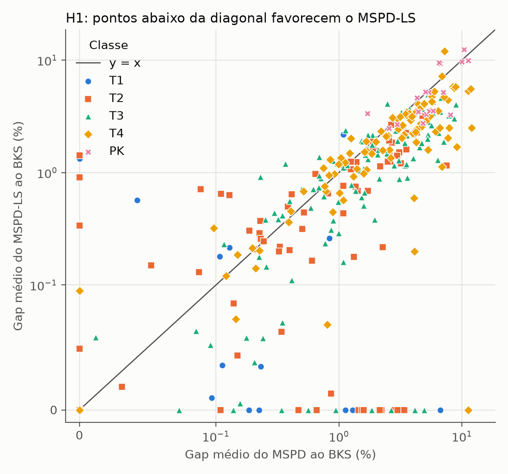
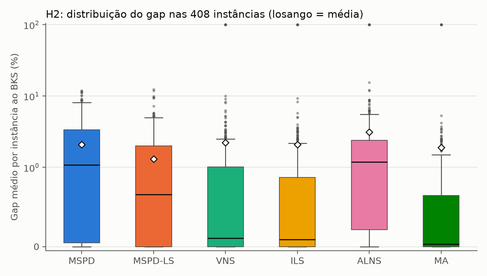
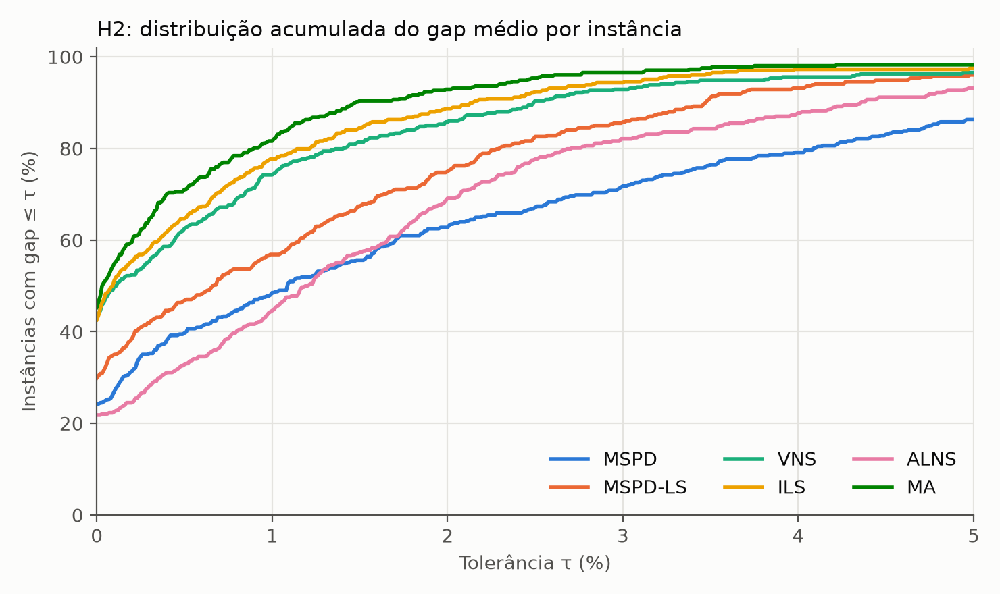
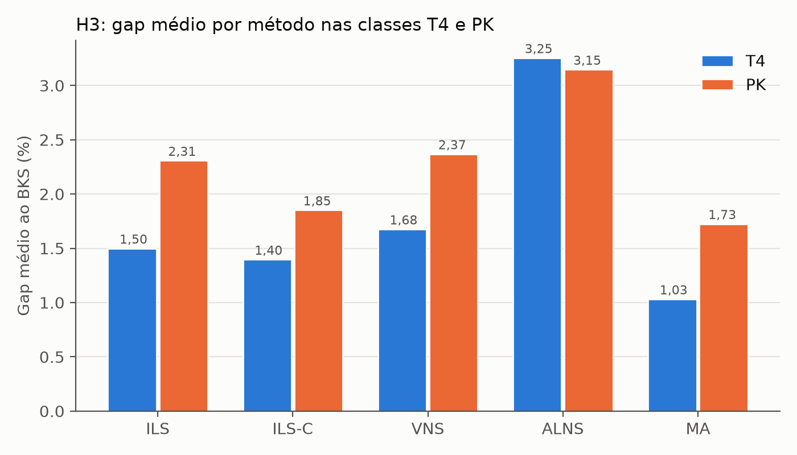

# Resultados e conclusões: heurísticas para o GCOP

Documento gerado por `analise/gera_documento.py` a partir dos resultados brutos. Hipóteses numeradas como em `tp3-heu.pdf` (H1 a H3); a formulação exata é só a referência para o BKS e o ótimo.

## 1. Vereditos

| Hipótese | Veredito | Evidência |
|---|---|---|
| H1: BL reduz o gap em relação ao refinamento σ | **confirmada** | Wilcoxon p < 0,0001; classes em que o MSPD-LS perde: nenhuma |
| H2: heurísticas propostas vencem o MSPD | **parcialmente confirmada** | Friedman p < 0,0001; vencem o MSPD: VNS, ILS, MA |
| H2 sem brg180 (402 instâncias) | **confirmada** | Friedman p < 0,0001; vencem o MSPD: VNS, ILS, ALNS, MA |
| H2: o MA é o melhor | **confirmada** | menor rank médio: MA |
| H3: clusters espalhados exigem troca de representante | **confirmada** | degradação do ILS maior que a do VNS e a do ALNS: sim; ILS-C < ILS em PK: p = 0,0088 |

Referência exata: 234 ótimos provados em 294 instâncias de T1 a T3.

## 2. Ambiente e execução

| Item | Valor |
|---|---|
| CPU | AMD Ryzen 5 5500 |
| Núcleos físicos / lógicos | 6 / 12 |
| RAM (GB) | 17.0 |
| Sistema | Windows-10-10.0.19045-SP0 |
| Compilador | g++ (Rev2, Built by MSYS2 project) 14.2.0 |
| Opções de compilação | -std=c++17 -static |
| Processos simultâneos | 5 (exata: 5 nas 208 primeiras instâncias e 4 nas 86 restantes, por falta de memória) |
| Limite da formulação exata (s) | 600 |
| HiGHS | 1.15.1 |
| Python | 3.11.8 |
| numpy / pandas / scipy / matplotlib | 2.4.6 / 3.1.0 / 1.17.1 / 3.11.2 |

- Execuções analisadas: 25620 de 25620 previstas; 408 instâncias com os seis métodos.
- Falhas de execução: 0. Execuções sem solução viável (gap de 100%): 240.
- Rotas divergentes na reavaliação independente em Python: 0.
- Instâncias em que uma heurística superou um ótimo declarado: 0 (deve ser 0).
- Excesso sobre t(n): percentil 99 de 0,021 s e máximo de 0,177 s.

**Compilação e limite da exata:** o artigo cita só g++ 14.2.0 e C++17; a execução usou as opções registradas acima, sem `-O2`, por decisão da equipe. O limite por instância da formulação exata é o registrado acima.

## 3. Hipótese 1

**H1: MSPD versus MSPD-LS por classe (p: Wilcoxon unilateral a favor do MSPD-LS)**

| Classe   |   n |   Gap MSPD (%) |   Gap MSPD-LS (%) | Iter. MSPD   | Iter. MSPD-LS   | Melhoria MSPD (ms)   | Melhoria MSPD-LS (ms)   | V/E/D MSPD-LS   | p       |
|:---------|----:|---------------:|------------------:|:-------------|:----------------|:---------------------|:------------------------|:----------------|:--------|
| T1       |  96 |          0,241 |             0,071 | 3414,8       | 4336,4          | 0,47                 | 0,34                    | 14/75/7         | 0,0521  |
| T2       |  78 |          1,274 |             0,651 | 403,1        | 482,1           | 3,58                 | 2,74                    | 48/13/17        | <0,0001 |
| T3       | 120 |          2,365 |             1,360 | 243,5        | 283,8           | 10,29                | 8,02                    | 85/7/28         | <0,0001 |
| T4       |  96 |          3,512 |             2,205 | 94,5         | 109,1           | 64,60                | 51,47                   | 70/4/22         | <0,0001 |
| PK       |  18 |          5,972 |             5,524 | 157,7        | 145,7           | 38,35                | 43,83                   | 12/0/6          | 0,1746  |
| Total    | 408 |          2,086 |             1,304 | 981,4        | 1228,1          | 20,71                | 17,01                   | 229/99/80       | <0,0001 |

*Gap do MSPD (x) e do MSPD-LS (y) por instância; cor e marcador indicam a classe*

Critério: confirmada se p < 0,05 e o MSPD-LS não for pior em nenhuma classe; parcial se p < 0,05 mas pior em alguma; refutada se p ≥ 0,05. As colunas de iterações e de tempo de melhoria indicam se um ganho vem de uma melhoria mais eficaz ou de mais reinícios.

## 4. Hipótese 2

**H2: medidas por método (Friedman p = <0,0001)**

| Método   |   Gap médio (%) |   Gap máximo (%) |   Gap melhor semente (%) |   Desvio entre sementes (%) |   Atinge BKS (%) |   Tempo até a melhor (s) |   Rank médio |
|:---------|----------------:|-----------------:|-------------------------:|----------------------------:|-----------------:|-------------------------:|-------------:|
| MSPD     |           2,086 |           15,207 |                    1,539 |                       0,353 |           27,819 |                    1,540 |        4,616 |
| MSPD-LS  |           1,304 |           15,639 |                    0,865 |                       0,295 |           35,123 |                    1,470 |        3,912 |
| VNS      |           2,216 |          100,000 |                    1,875 |                       0,256 |           51,936 |                    1,745 |        2,904 |
| ILS      |           2,083 |          100,000 |                    1,744 |                       0,253 |           52,525 |                    1,855 |        2,630 |
| ALNS     |           3,131 |          100,000 |                    2,341 |                       0,517 |           27,304 |                    0,474 |        4,700 |
| MA       |           1,907 |          100,000 |                    1,537 |                       0,306 |           59,608 |                    1,850 |        2,238 |

**H2: Wilcoxon unilateral pareado por instância, com correção de Holm em cada família**

| Família                      | Comparação   | V/E/D      |   Dif. média (p.p.) | p bruto   | p Holm   |
|:-----------------------------|:-------------|:-----------|--------------------:|:----------|:---------|
| Heurística proposta vs. MSPD | VNS < MSPD   | 263/100/45 |               0,131 | <0,0001   | <0,0001  |
| Heurística proposta vs. MSPD | ILS < MSPD   | 286/97/25  |              -0,002 | <0,0001   | <0,0001  |
| Heurística proposta vs. MSPD | ALNS < MSPD  | 159/83/166 |               1,046 | 0,0972    | 0,0972   |
| Heurística proposta vs. MSPD | MA < MSPD    | 299/100/9  |              -0,178 | <0,0001   | <0,0001  |
| MA vs. propostos             | MA < MSPD-LS | 268/121/19 |               0,603 | <0,0001   | <0,0001  |
| MA vs. propostos             | MA < VNS     | 168/169/71 |              -0,309 | <0,0001   | <0,0001  |
| MA vs. propostos             | MA < ILS     | 166/168/74 |              -0,176 | <0,0001   | <0,0001  |
| MA vs. propostos             | MA < ALNS    | 307/95/6   |              -1,224 | <0,0001   | <0,0001  |

**Complemento de H2: gap médio ao BKS (%) por classe**

| Classe   |   MSPD |   MSPD-LS |   VNS |   ILS |   ALNS |    MA | Menor rank   |
|:---------|-------:|----------:|------:|------:|-------:|------:|:-------------|
| T1       |  0,241 |     0,071 | 0,016 | 0,002 |  0,122 | 0,000 | MA           |
| T2       |  1,274 |     0,651 | 0,251 | 0,137 |  1,196 | 0,080 | MA           |
| T3       |  2,365 |     1,360 | 5,663 | 5,447 |  6,696 | 5,349 | MA           |
| T4       |  3,512 |     2,205 | 1,676 | 1,499 |  3,254 | 1,032 | MA           |
| PK       |  5,972 |     5,524 | 2,369 | 2,308 |  3,147 | 1,725 | MA           |

*Distribuição do gap médio por instância*

*Porcentagem de instâncias com gap até τ*

Rank médio: MA 2,24, ILS 2,63, VNS 2,90, MSPD-LS 3,91, MSPD 4,62, ALNS 4,70.

**H2: sensibilidade à exclusão das 6 instâncias brg180 (408 e 402 instâncias; Friedman sem brg180 p = <0,0001)**

| Método   |   Gap com brg180 (%) |   Gap sem brg180 (%) | Rank com   | Rank sem   | p Holm vs. MSPD com   | p Holm vs. MSPD sem   |
|:---------|---------------------:|---------------------:|:-----------|:-----------|:----------------------|:----------------------|
| MSPD     |                2,086 |                2,081 | 4,62       | 4,66       | -                     | -                     |
| MSPD-LS  |                1,304 |                1,289 | 3,91       | 3,95       | -                     | -                     |
| VNS      |                2,216 |                0,757 | 2,90       | 2,88       | <0,0001               | <0,0001               |
| ILS      |                2,083 |                0,622 | 2,63       | 2,60       | <0,0001               | <0,0001               |
| ALNS     |                3,131 |                1,685 | 4,70       | 4,70       | 0,0972                | 0,0321                |
| MA       |                1,907 |                0,443 | 2,24       | 2,20       | <0,0001               | <0,0001               |

Nas 6 instâncias brg180, VNS, ILS, ALNS e MA não encontram solução viável (gap de 100%). Sem elas, o veredito da H2 passa a **confirmada**.

## 5. Hipótese 3

**H3: gap por classe e degradação (ILS-C < ILS em PK: Wilcoxon unilateral p = 0,0088)**

| Método   |   Gap T4 (%) |   Gap PK (%) |   Degradação (p.p.) |
|:---------|-------------:|-------------:|--------------------:|
| ILS      |        1,499 |        2,308 |               0,809 |
| ILS-C    |        1,397 |        1,852 |               0,455 |
| VNS      |        1,676 |        2,369 |               0,692 |
| ALNS     |        3,254 |        3,147 |              -0,107 |
| MA       |        1,032 |        1,725 |               0,694 |

*Gap médio por método nas classes T4 e PK*

Vitórias/empates/derrotas do ILS-C contra o ILS em PK: 13/0/5. Como PK tem 18 instâncias e difere de T4 em mais de um aspecto, um efeito é atribuído à combinação dessas características, e não a uma delas isoladamente.

## 6. Referência exata (T1 a T3)

**Referência: resolução da formulação exata por classe**

| Classe   |   Instâncias |   Ótimo provado | Tempo médio resolvidas (s)   | Limitante - BKS nas não resolvidas (%)   |
|:---------|-------------:|----------------:|:-----------------------------|:-----------------------------------------|
| T1       |           96 |              96 | 14,3                         | n/d                                      |
| T2       |           78 |              72 | 55,4                         | 1,29                                     |
| T3       |          120 |              66 | 148,2                        | 5,92                                     |
| Total    |          294 |             234 | 64,7                         | 5,45                                     |

**Referência: gap ao ótimo nas 234 instâncias com ótimo provado**

| Método   |   T1 gap méd. |   T1 gap máx. | T1 % ótimas   |   T2 gap méd. |   T2 gap máx. | T2 % ótimas   |   T3 gap méd. |   T3 gap máx. | T3 % ótimas   |   Total gap méd. |   Total gap máx. | Total % ótimas   |
|:---------|--------------:|--------------:|:--------------|--------------:|--------------:|:--------------|--------------:|--------------:|:--------------|-----------------:|-----------------:|:-----------------|
| MSPD     |         0,241 |         6,667 | 83,2          |         1,288 |         7,692 | 24,4          |         1,900 |        10,377 | 12,4          |            1,031 |           10,377 | 45,2             |
| MSPD-LS  |         0,071 |         2,174 | 91,2          |         0,630 |         3,750 | 38,3          |         1,125 |         5,818 | 17,9          |            0,540 |            5,818 | 54,3             |
| VNS      |         0,016 |         2,174 | 99,2          |         0,222 |         3,846 | 74,9          |         5,169 |       100,000 | 36,1          |            1,533 |          100,000 | 73,9             |
| ILS      |         0,002 |         2,174 | 99,4          |         0,143 |         2,273 | 75,7          |         4,960 |       100,000 | 38,8          |            1,444 |          100,000 | 75,0             |
| ALNS     |         0,122 |         8,333 | 86,5          |         1,169 |         5,911 | 19,3          |         5,899 |       100,000 | 8,5           |            2,073 |          100,000 | 43,8             |
| MA       |         0,000 |         0,000 | 100,0         |         0,080 |         1,923 | 83,6          |         4,791 |       100,000 | 54,8          |            1,376 |          100,000 | 82,2             |

## 7. Conclusões

*Síntese automática dos critérios do artigo; a interpretação dos mecanismos deve ser feita pela equipe a partir das tabelas acima.*

- **H1 confirmada.** Com o mesmo multi-start e o mesmo tempo, a troca do refinamento σ pela BL obteve p < 0,0001.
- **H2 parcialmente confirmada.** 3 de 4 heurísticas propostas venceram o MSPD com p de Holm < 0,05. O menor rank médio foi de MA, e a afirmação de que o MA é o melhor foi confirmada.
- **H3 confirmada.**

## 8. Decisões de implementação e divergências

Pontos em que o artigo não define um detalhe, ou em que a execução difere dele:

- **Formulação exata:** o texto cita a "Seção 1.2", que não existe no PDF. Foi usada a formulação de arestas do artigo base com cortes de subciclo gerados iterativamente. A melhor rota das heurísticas entra como solução inicial do solver. Isso só acelera a prova: não altera o ótimo nem o limitante.
- **Número de clusters:** os arquivos dos autores têm um rótulo a mais que o cabeçalho (eil51: `Clusters 11`, 12 rótulos). Vale o rótulo de cada vértice, então K é o número de rótulos distintos.
- **Distâncias:** o texto diz "euclidianas", mas parte dos grafos vem de matrizes explícitas ou coordenadas geográficas da TSPLIB. Foram usadas as distâncias dos arquivos.
- **TSP e GTSP do orçamento:** os arquivos usam distâncias sem o arredondamento da TSPLIB, então os valores publicados não se aplicam diretamente. Os dois comprimentos vêm de um ILS sobre as distâncias dos arquivos (`dados/orcamento.csv`). Toda rota encontrada é um limitante superior válido, o que preserva a garantia B ≥ GTSP.
- **POKE:** as espécies obrigatórias são sorteadas entre as que têm ao menos duas ocorrências, para haver escolha de representante. O prêmio inverso à frequência é p = f_max / f_espécie.
- **REPARA:** sem vértice removível, aplica OTIMIZAROTA mais uma vez antes de declarar a solução inviável, porque a rota pode caber depois de encurtada.
- **Partida:** se INICIAL não for viável nas três construções, usa GRASP + REPARA + BL até obter solução viável ou esgotar o tempo.
- **ALNS:** uma solução de mesmo prêmio e mesmo comprimento é aceita sem pontuar, pois o Algoritmo 4 não a classifica. Os pesos não têm piso mínimo.
- **MA:** a melhor solução é sempre a melhor da população. Um filho com o mesmo conjunto de vértices de um indivíduo é rejeitado mesmo que seja mais curto, como no critério "inédito".
- **Interrupção por tempo:** a BL interrompida devolve a solução viável corrente; um REPARA interrompido descarta a solução.

## 9. Referências

Do artigo:

1. Álvarez-Miranda, E.; Luipersbeck, M.; Sinnl, M. Gotta (efficiently) catch them all: Pokémon GO meets orienteering problems. *European Journal of Operational Research*, 265(2):779-794, 2018.
2. Croes, G. A. A method for solving traveling-salesman problems. *Operations Research*, 6(6):791-812, 1958.
3. Fischetti, M.; Salazar-González, J. J.; Toth, P. A branch-and-cut algorithm for the symmetric generalized traveling salesman problem. *Operations Research*, 45(3):378-394, 1997.
4. Lourenço, H. R.; Martin, O. C.; Stützle, T. Iterated local search. In *Handbook of Metaheuristics*, p. 320-353. Kluwer, 2003.
5. Mladenović, N.; Hansen, P. Variable neighborhood search. *Computers & Operations Research*, 24(11):1097-1100, 1997.
6. Moscato, P. On evolution, search, optimization, genetic algorithms and martial arts: towards memetic algorithms. Technical Report C3P 826, Caltech, 1989.
7. Or, I. *Traveling Salesman-Type Combinatorial Problems and Their Relation to the Logistics of Regional Blood Banking*. PhD thesis, Northwestern University, 1976.
8. Penicka, R.; Faigl, J.; Saska, M. Variable neighborhood search for the set orienteering problem and its application to other orienteering problem variants. *European Journal of Operational Research*, 276(3):816-825, 2019.
9. Ropke, S.; Pisinger, D. An adaptive large neighborhood search heuristic for the pickup and delivery problem with time windows. *Transportation Science*, 40(4):455-472, 2006.
10. Sevkli, Z.; Sevilgen, F. E. Variable neighborhood search for the orienteering problem. In *ISCIS 2006*, LNCS 4263, p. 134-143. Springer, 2006.
11. Takahashi, H.; Matsuyama, A. An approximate solution for the Steiner problem in graphs. *Mathematica Japonica*, 24(6):573-577, 1980.
12. Tsiligirides, T. Heuristic methods applied to orienteering. *Journal of the Operational Research Society*, 35(9):797-809, 1984.
13. Vansteenwegen, P.; Souffriau, W.; Vanden Berghe, G.; Van Oudheusden, D. Iterated local search for the team orienteering problem with time windows. *Computers & Operations Research*, 36(12):3281-3290, 2009.

Acrescentadas para os testes:

14. Friedman, M. The use of ranks to avoid the assumption of normality implicit in the analysis of variance. *Journal of the American Statistical Association*, 32(200):675-701, 1937.
15. Holm, S. A simple sequentially rejective multiple test procedure. *Scandinavian Journal of Statistics*, 6(2):65-70, 1979.
16. Huangfu, Q.; Hall, J. A. J. Parallelizing the dual revised simplex method. *Mathematical Programming Computation*, 10(1):119-142, 2018. (HiGHS)
17. Martin, O.; Otto, S. W.; Felten, E. W. Large-step Markov chains for the traveling salesman problem. *Complex Systems*, 5(3):299-326, 1991. (perturbação do ILS que calcula o orçamento)
18. Pratt, J. W. Remarks on zeros and ties in the Wilcoxon signed rank procedures. *Journal of the American Statistical Association*, 54(287):655-667, 1959.
19. Reinelt, G. TSPLIB: a traveling salesman problem library. *ORSA Journal on Computing*, 3(4):376-384, 1991.
20. Wilcoxon, F. Individual comparisons by ranking methods. *Biometrics Bulletin*, 1(6):80-83, 1945.
