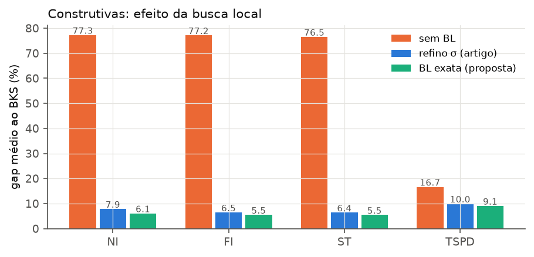
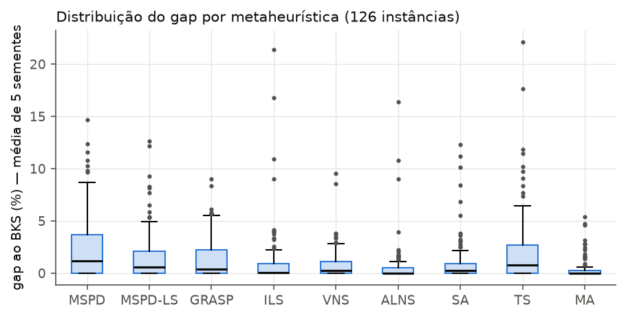
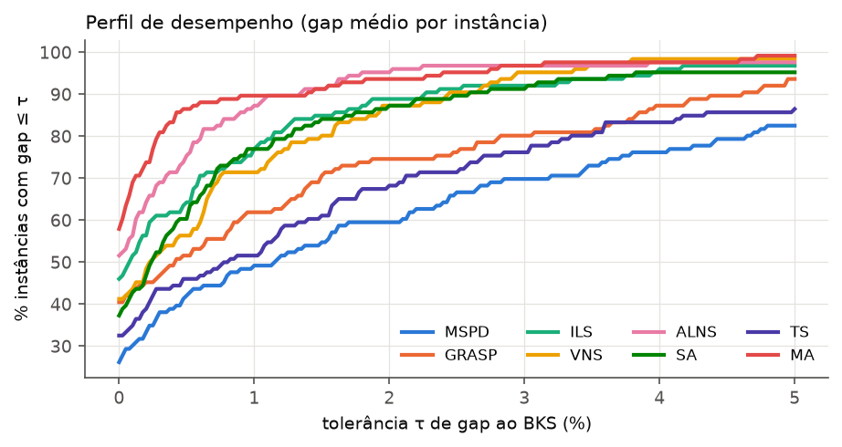
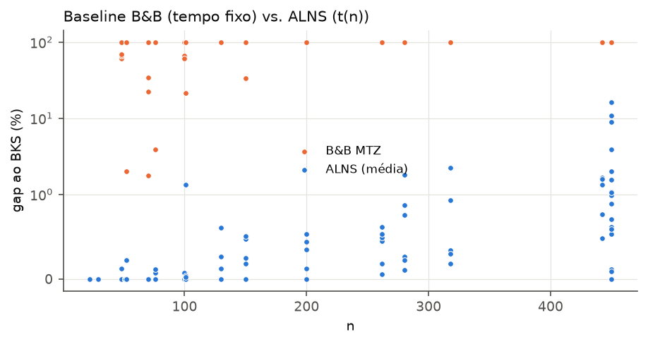
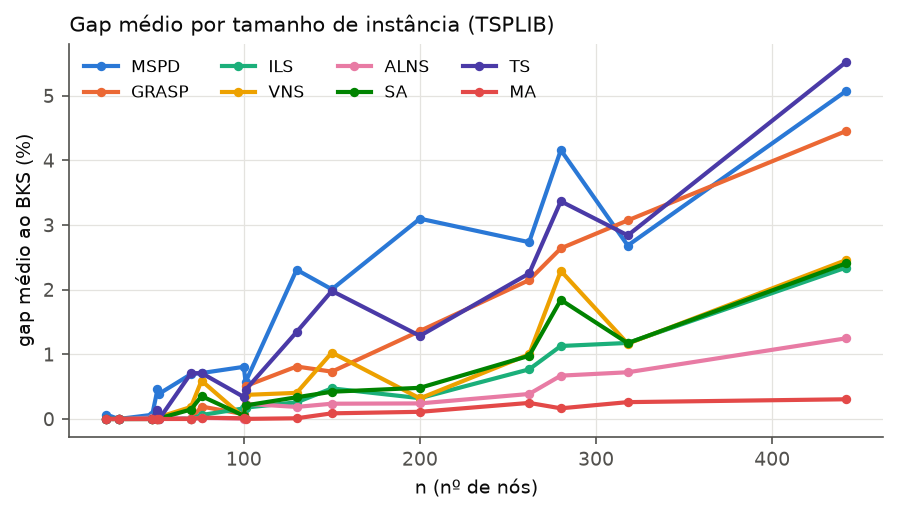
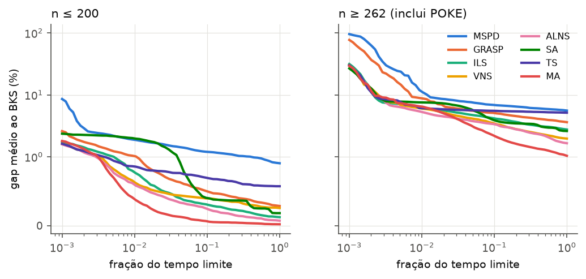
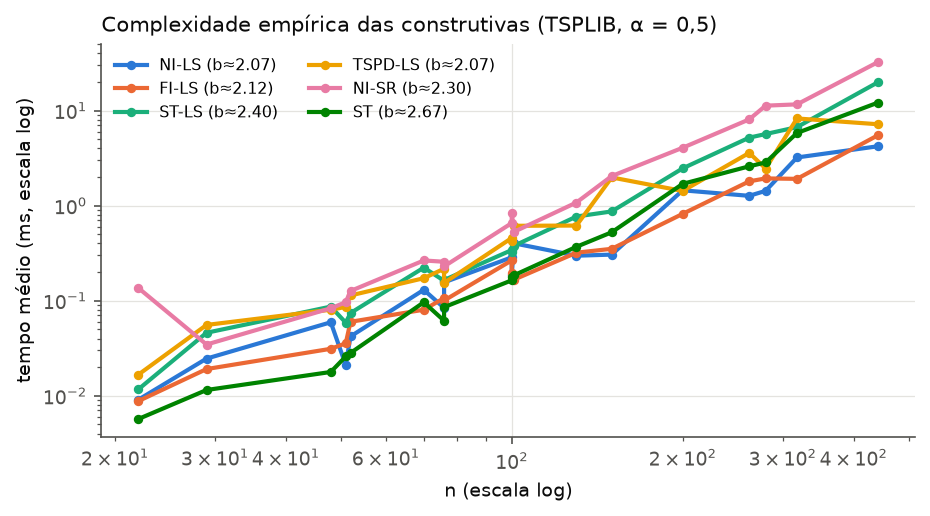

# Resultados preliminares — Heurísticas para o GCOP

> Bateria preliminar executada em 09/10/2026 seguindo o protocolo de [`metodologia.md`](metodologia.md)
> (§7–§9). Todas as tabelas numeradas (T0–T11) são geradas por `scripts/analyze.py` em
> [`results/tables.md`](../results/tables.md) — inclusive as que aqui aparecem resumidas (T0 por instância
> e T10 por instância × método). Os dados brutos (uma linha JSON por execução, com o tour) estão em `results/*.jsonl`.

## Sumário executivo

| Hipótese | Veredito | Evidência principal |
|---|---|---|
| **H1** BL exata > refino σ do artigo | **Confirmada** | LS melhor em 263 pares, pior em 139 (Wilcoxon p = 2·10⁻⁷) e 2–3× mais rápida |
| **H2** metaheurísticas propostas > MSPD (controle) | **Confirmada** | Friedman p = 10⁻⁸²; as 8 alternativas vencem o MSPD com p_Holm < 0,01; MA: gap 0,36% vs 2,47% |
| **H3** heurísticas em segundos ≥ B&B de tempo fixo | **Confirmada** | MA ≥ BB em 100% das instâncias; > BB em 97% das com n > 100 (BB sem solução viável para n ≥ 262) |
| **H4** gap ao ótimo ≤ 0,5% | **Confirmada** | MA: 0,00% (ótimo em 97% das execuções); ALNS: 0,05%; o controle MSPD: 0,59% |
| **H5** dificuldade cresce com n, α e em POKE | **Parcial** | cresce com n (ρ = 0,74–0,87) e é maior em POKE; **diminui** com α (refutado) |
| **H6** local branching melhora o MSPD em ≥ 50% | **Refutada** | melhora em 20% (n ≤ 52), 28% (70–101) e 0% (130–200) |

Ranking geral (rank médio de Friedman, menor é melhor): **MA (2,95)** < ALNS (3,29) < ILS (4,13) < VNS (4,55)
< SA (4,64) < GRASP (5,65) < MSPD-LS (6,05) < TS (6,58) < MSPD (7,16).

---

## 1. Execução realizada

| Grupo | Execuções | Configuração | Observação |
|---|---|---|---|
| Construtivas | 126 × 12 = 1.512 | NI, FI, ST, TSPD × {sem BL, SR, LS} | determinísticas, 1 execução |
| Metaheurísticas | 126 × 9 × 5 = 5.670 | MSPD, MSPD-LS, GRASP, ILS, VNS, ALNS, SA, TS, MA | t(n) = max(1, n/50) s; 4–6 processos paralelos |
| EXACT (CUT) | 84 | n ≤ 200, 600 s | + 6 tentativas em POKE abortadas (memória) |
| BB (MTZ) | 126 | **300 s** | metade dos 600 s previstos (tempo de máquina) |
| LBR | 84 | n ≤ 200; MSPD t(n) + LB até 60 s | k = 2, 4, 6; 20 s por vizinhança |
| Complexidade | 21 × 12 | 5–50 repetições por medida | instância α = 0,5 de cada grafo |

**Desvios em relação ao protocolo** (a registrar no TP): (i) o BB usou 300 s em vez de 600 s; (ii) o
EXACT não foi rodado nas instâncias POKE (n = 450): as 6 tentativas feitas não produziram limitantes úteis
em 600 s e consumiam muita memória — os limitantes superiores de POKE vêm do BB-MTZ; (iii) parte das
execuções de heurísticas ocorreu concorrente com execuções MIP (no máximo 10 processos em 12 *threads*),
o que pode reduzir o número de iterações das metaheurísticas, mas afeta todas de forma semelhante;
(iv) TSP de referência do orçamento obtido heuristicamente (ver metodologia §8.1).

**Validação.** Toda solução reportada passou por verificação independente (nós distintos, todos os
clusters cobertos, comprimento ≤ B recalculado do zero). Nas 66 instâncias em que o EXACT provou o ótimo,
nenhuma heurística reportou prêmio acima do ótimo, e o BB nunca superou o BKS das heurísticas — uma
checagem cruzada de correção dos dois lados.

**Falhas observadas.** As 3 variantes TSPD (raw, SR, LS) **não encontraram solução viável** em
`cityB_B10_spec`: a remoção a partir do tour gigante protege os únicos representantes de cada cluster;
com orçamento apertado (10 km), clusters espalhados e distâncias não métricas, o tour resultante ainda
excede B e o reparo não converge. Todas as demais 7.179 execuções heurísticas foram viáveis.

---

## 2. Referências de qualidade (T0)

- **Ótimos provados:** 66 das 84 instâncias com n ≤ 200 (todas as 30 de n ≤ 52, em até 189 s; 30 de 36 em
  70–101; 6 de 18 em 130–200). Tempo do EXACT: de 0,2 s (ulysses22) a 579 s (eil101, α = 0,25, uniforme).
  A família **pr76** é a mais difícil (só α = 0,75 uniforme resolvida), exatamente como no artigo base,
  que também destaca o pr76 como excepcionalmente difícil.
- **Instâncias sem ótimo:** distância média do BKS ao menor limitante superior disponível:

| Classe | inst. sem ótimo | gap BKS→UB médio | máx. |
|---|---|---|---|
| B: 70–101 | 6 | 2,40% | 4,40% |
| C: 130–200 | 12 | 0,92% | 1,79% |
| D: 262–442 (UB do BB-MTZ) | 24 | 4,63% | 30,1%* |
| E: POKE (UB do BB-MTZ) | 18 | 22,5% | 39,2% |

\* pcb442 α = 0,25 uniforme, cujo UB é o trivial (n = 442). Em D e E os limitantes vêm da relaxação MTZ,
que é fraca; logo esses gaps são **cotas superiores frouxas** do gap real e não indicam má qualidade.

---

## 3. H1 — Busca local exata vs. refinamento σ do artigo

**Tabela T1 — construtivas (126 instâncias): gap médio ao BKS e tempo médio**

| Construtiva | gap sem BL | gap SR (artigo) | gap LS (proposta) | tempo SR (ms) | tempo LS (ms) |
|---|---|---|---|---|---|
| NI | 77,29% | 7,87% | **6,08%** | 6,73 | **2,30** |
| FI | 77,15% | 6,46% | **5,51%** | 6,82 | **2,28** |
| ST | 76,53% | 6,40% | **5,48%** | 8,55 | **3,89** |
| TSPD | 16,67% | 9,96% | **9,07%** | 10,07 | **6,95** |

**T1b — por classe de tamanho (gap %)**

| | n ≤ 52 | 70–101 | 130–200 | 262–442 | POKE |
|---|---|---|---|---|---|
| NI-SR / NI-LS | 2,69 / **1,86** | 5,43 / **4,41** | 9,50 / **6,71** | 9,88 / **7,88** | 17,09 / **13,43** |
| FI-SR / FI-LS | **2,42** / 3,16 | 4,26 / **3,93** | 6,47 / **4,35** | 8,59 / **7,72** | 14,73 / **10,78** |
| ST-SR / ST-LS | 2,37 / **2,07** | **3,71** / 3,84 | 7,07 / **5,55** | 7,75 / **6,24** | 16,03 / **13,33** |
| TSPD-SR / TSPD-LS | **1,75** / 1,89 | **4,96** / 5,18 | 8,17 / **7,59** | 7,29 / **6,79** | 39,00 / **33,33** |

**Discussão.**

- As construtivas puras do GTSP (NI, FI, ST) visitam só ~1 nó por cluster e ficam a ~77% do BKS. A
  fase de melhoria é o que produz qualidade, como o artigo antecipava. A TSPD, que já parte de um tour
  com quase todos os nós, começa muito melhor (16,7%).
- Nos 503 pares válidos (instância × construtiva), a LS supera a SR em 263, perde em 139 e empata em 101
  (Wilcoxon unilateral p = 2,0·10⁻⁷). Ela é também **2–3× mais rápida**, porque a SR recalcula σ (O(nm)) a
  cada inserção, enquanto a LS mantém um *cache* de custos.
- A vantagem cresce com o tamanho: em n ≤ 101 há casos em que a SR vence (FI e TSPD), mas a partir de
  130 nós a LS vence em todas as construtivas. Em POKE a diferença chega a 4 pontos percentuais.
  Interpretação: σ usa a distância ao vizinho mais próximo, um *proxy* do custo de inserção que piora
  quando o tour é longo ou as distâncias não são métricas.
- Entre as construtivas com LS, **ST-LS** e **FI-LS** são as melhores (≈ 5,5%), e não há dominância entre
  NI e ST — em linha com o artigo, que sorteia entre as duas.

**Veredito: H1 confirmada.** A LS é melhor (p < 0,05) e mais rápida que a SR. Há exceções pontuais em
instâncias pequenas.

---

## 4. H2 — Metaheurísticas propostas vs. controle MSPD

**Tabela T2 — desempenho global (126 instâncias × 5 sementes)**

| Método | gap médio | gap melhor semente | desvio entre sementes | % exec. = BKS | % inst. com BKS (alguma semente) | gap máx. | t até melhor (s) | t melhor / t lim | iterações | rank médio |
|---|---|---|---|---|---|---|---|---|---|---|
| MSPD (controle) | 2,47 | 2,16 | 0,26 | 28,1 | 30,2 | 14,68 | 1,62 | 0,32 | 4.731 | 7,16 |
| MSPD-LS (ablação) | 1,62 | 1,38 | 0,21 | 36,2 | 39,7 | 12,66 | 1,53 | 0,30 | 8.353 | 6,05 |
| GRASP | 1,40 | 1,08 | 0,25 | 43,2 | 48,4 | 9,02 | 1,64 | 0,32 | 9.889 | 5,65 |
| ILS | 1,00 | 0,79 | 0,19 | 49,5 | 54,8 | 21,42 | 1,93 | 0,34 | 22.104 | 4,13 |
| VNS | 0,83 | 0,50 | 0,28 | 47,6 | 56,4 | 9,57 | 1,42 | 0,23 | 16.026 | 4,55 |
| ALNS | 0,60 | 0,43 | **0,14** | 56,2 | 65,9 | 16,42 | 2,08 | 0,39 | 25.190 | 3,29 |
| SA | 0,97 | 0,58 | 0,30 | 46,7 | 57,9 | 12,29 | 2,37 | 0,44 | 7.070.661 | 4,64 |
| TS | 2,10 | 1,91 | 0,16 | 36,4 | 40,5 | 22,13 | 1,03 | 0,18 | 71.926 | 6,58 |
| **MA** | **0,36** | **0,07** | 0,31 | **72,2** | **92,1** | **5,42** | 1,64 | 0,25 | 17.558 | **2,95** |

Friedman (9 métodos, 126 instâncias): χ² = 405,4, p = 1,3·10⁻⁸².

**Tabela T2b — Wilcoxon pareado (unilateral, gap do método < gap do MSPD), correção de Holm**

| Método | vence MSPD | perde | empata | p (Holm) |
|---|---|---|---|---|
| MA | 92 | 1 | 33 | 9,2·10⁻¹⁶ |
| ALNS | 89 | 2 | 35 | 2,0·10⁻¹⁵ |
| ILS | 88 | 4 | 34 | 4,5·10⁻¹⁴ |
| SA | 86 | 12 | 28 | 4,0·10⁻¹³ |
| VNS | 81 | 16 | 29 | 2,1·10⁻¹² |
| MSPD-LS | 76 | 14 | 36 | 1,6·10⁻¹¹ |
| GRASP | 77 | 15 | 34 | 1,9·10⁻¹¹ |
| TS | 57 | 39 | 30 | 9,9·10⁻³ |

**Discussão.**

- **MA** é o melhor método em média, no pior caso (gap máximo de 5,4% contra 9–22% dos outros) e em
  cobertura do BKS: atinge o BKS em 92% das instâncias em ao menos uma semente. Seu ponto fraco é a
  variabilidade entre sementes (0,31), a maior do grupo. Isso sugere que um MA com mais tempo, ou com
  reinícios da população, seria ainda mais forte.
- **ALNS** é o segundo melhor e o **mais estável** (desvio de 0,14). No perfil de desempenho (F4), MA e
  ALNS dominam todos os demais em todo o intervalo τ ∈ [0, 5]%.
- **ILS, VNS e SA** formam um grupo intermediário estatisticamente próximo (rank 4,1–4,6).
  - O ILS tem um gap máximo alto (21%), concentrado em POKE: a perturbação por segmento consecutivo
    não troca o representante de clusters espalhados.
  - O SA faz ~7 milhões de movimentos por execução, mas usa o tempo de forma "tardia": é o que encontra
    a melhor solução mais perto do fim (t melhor / t lim = 0,44).
- A ablação **MSPD-LS** isola o efeito da busca local: só trocar o refino σ pela LS reduz o gap do MSPD
  de 2,47% para 1,62% (−34%) e quase dobra o número de iterações. Isso reforça H1 dentro de uma
  metaheurística.
- **TS** foi a mais fraca das propostas (ainda assim melhor que o MSPD, p = 0,01). Encontra sua melhor
  solução cedo (18% do tempo) e estagna: a vizinhança amostrada de trocas e a intensificação por retorno
  à melhor solução não diversificam o suficiente. É candidata a ajuste (tenure, amostragem maior,
  diversificação por frequência) antes da bateria final.
- O **MSPD**, na configuração original do artigo (10 iterações), é bem pior que com o tempo t(n)
  (Tabela T9). Com 10 iterações o gap vai de 0,87% (n ≤ 52) a 5,65% (262–442) e 12,3% (POKE); com t(n),
  de 0,20% a 3,66% e 8,15%.

**Veredito: H2 confirmada.** Friedman p < 0,05 e as 8 alternativas têm gap menor que o MSPD com
p_Holm < 0,05. As melhores são MA e ALNS.

---

## 5. H3 — Heurísticas (segundos) vs. B&B de tempo fixo

**Tabela T6 — B&B (MTZ, 300 s) vs. metaheurísticas (t(n) ≤ 9 s)**

| Classe | inst. | BB com solução viável | gap BB→BKS | gap do BB ao próprio UB* | gap ALNS | gap melhor meta |
|---|---|---|---|---|---|---|
| A: n ≤ 52 | 30 | 76,7% | 32,2% | 11,9% | 0,01% | 0,00% |
| B: 70–101 | 36 | 38,9% | 67,0% | 16,0% | 0,05% | 0,00% |
| C: 130–200 | 18 | 5,6% | 96,3% | 36,1% | 0,22% | 0,05% |
| D: 262–442 | 24 | **0%** | 100% | — | 0,76% | 0,24% |
| E: POKE | 18 | **0%** | 100% | — | 2,86% | 1,02% |

\* média apenas sobre as instâncias em que o BB achou solução; gap BB→BKS conta 100% quando não há solução.

Comparação instância a instância (prêmio médio das 5 sementes vs. BB): vitórias / empates / derrotas
— MA 101/25/0, ALNS 101/24/1, ILS 101/24/1, VNS 101/22/3, GRASP 101/21/4, SA 101/21/4, MSPD-LS 101/20/5,
TS 101/19/6, MSPD 100/17/9.

**Discussão.**

- O BB-MTZ prova o ótimo em 25 instâncias (todas com n ≤ 52; 42 s em média, no máximo 218 s) e só acha
  solução viável em 26 das 126. Para n ≥ 262 **não encontra nenhuma solução viável** em 300 s. Isso
  reproduz a conclusão do artigo de que a formulação compacta MTZ só é competitiva até ~30 nós.
- Os empates são as instâncias pequenas resolvidas à otimalidade pelo BB, nas quais as heurísticas também
  acham o ótimo. Em nenhuma instância o BB superou o BKS heurístico.
- O MA tem prêmio médio ≥ BB em **100%** das instâncias e estritamente maior em **97%** das 66 com
  n > 100. O ALNS: 99,2% e 97%.
- O limitante dual do BB é útil por si só: é a única cota superior disponível para n ≥ 262 (§2).

**Veredito: H3 confirmada** (≥ 90% e maioria estrita em n > 100). Ressalva: com 300 s e não 600 s. Dado
que para n ≥ 262 o BB nem encontra solução viável, não se espera que dobrar o tempo mude o veredito;
a bateria final com 600 s confirmará.

---

## 6. H4 — Distância ao ótimo

**Tabela T5 — 66 instâncias com ótimo provado (330 execuções por método)**

| Método | gap médio ao ótimo | % execuções ótimas |
|---|---|---|
| MSPD | 0,59% | 50,6% |
| MSPD-LS | 0,31% | 63,0% |
| GRASP | 0,16% | 74,2% |
| ILS | 0,08% | 82,7% |
| VNS | 0,15% | 77,6% |
| ALNS | 0,05% | 87,0% |
| SA | 0,10% | 79,1% |
| TS | 0,39% | 63,3% |
| **MA** | **0,00%** (0,003%) | **97,0%** |

**Discussão.** As instâncias com ótimo conhecido são as menores e mais fáceis (n ≤ 200), então T5
superestima a qualidade em instâncias grandes. Mesmo assim:

- Todas as propostas ficam abaixo de 0,5%. O controle MSPD fica acima (0,59%).
- O MA acha o ótimo em 320 das 330 execuções, em ≤ 4 s.
- Para as 18 instâncias com n ≤ 200 sem ótimo provado, o BKS está a 0,92–2,40% do limitante superior
  do CUT (§2). Parte dessa distância é do limitante, não da solução.

**Veredito: H4 confirmada** (MA: 0,00%; ALNS: 0,05% ≤ 0,5%).

---

## 7. H5 — Fatores de dificuldade

**Tabela T3 — gap médio por classe de tamanho**

| Classe | MSPD | MSPD-LS | GRASP | ILS | VNS | ALNS | SA | TS | MA |
|---|---|---|---|---|---|---|---|---|---|
| A: n ≤ 52 | 0,20 | 0,06 | 0,01 | 0,01 | 0,01 | 0,01 | 0,02 | 0,03 | **0,00** |
| B: 70–101 | 0,72 | 0,31 | 0,17 | 0,10 | 0,30 | 0,05 | 0,19 | 0,54 | **0,01** |
| C: 130–200 | 2,47 | 1,32 | 0,97 | 0,35 | 0,58 | 0,22 | 0,41 | 1,54 | **0,07** |
| D: 262–442 | 3,66 | 2,53 | 3,08 | 1,35 | 1,73 | 0,76 | 1,60 | 3,50 | **0,24** |
| E: POKE (450) | 8,15 | 5,92 | 4,35 | 4,63 | 2,29 | 2,86 | 3,86 | 7,37 | **2,10** |

**Tabela T4 — gap médio por folga de orçamento α e esquema de prêmio**

| Grupo | MSPD | MSPD-LS | GRASP | ILS | VNS | ALNS | SA | TS | MA |
|---|---|---|---|---|---|---|---|---|---|
| TSPLIB α=0,25 unif | 3,06 | 1,51 | 1,28 | 0,78 | 0,79 | 0,47 | 0,59 | 1,70 | 0,13 |
| TSPLIB α=0,25 rand | 1,54 | 0,98 | 1,10 | 0,40 | 0,83 | 0,23 | 0,77 | 1,46 | 0,10 |
| TSPLIB α=0,50 unif | 2,37 | 1,23 | 1,20 | 0,50 | 0,58 | 0,24 | 0,44 | 1,54 | 0,07 |
| TSPLIB α=0,50 rand | 0,86 | 0,76 | 0,81 | 0,30 | 0,48 | 0,14 | 0,53 | 0,93 | 0,05 |
| TSPLIB α=0,75 unif | 0,91 | 0,55 | 0,65 | 0,22 | 0,51 | 0,16 | 0,32 | 1,20 | 0,03 |
| TSPLIB α=0,75 rand | 0,37 | 0,37 | 0,39 | 0,18 | 0,31 | 0,10 | 0,31 | 0,50 | 0,03 |
| POKE prêmio uniforme | 8,56 | 5,40 | 4,57 | 3,87 | 2,23 | 3,36 | 3,17 | 5,92 | 1,36 |
| POKE prêmio por espécie | 7,73 | 6,44 | 4,13 | 5,39 | 2,36 | 2,35 | 4,55 | 8,82 | 2,84 |

**Discussão.**

- **Tamanho.** A correlação de Spearman entre n e gap (TSPLIB) é positiva e significativa para todos os
  métodos: ρ = 0,74 (MA, VNS) a 0,87 (GRASP), p < 10⁻¹⁹. Na F2, MA e ALNS crescem devagar (≤ 1,25% em
  n = 442), enquanto MSPD, TS e GRASP chegam a 4,5–5,5%.
- **Folga do orçamento.** O efeito é o **oposto** do previsto: o gap médio cai de 0,98% (α = 0,25) para
  0,72% (0,5) e 0,40% (0,75) (Kruskal-Wallis p = 0,003).
  - Com orçamento apertado, a restrição de clusters consome boa parte de B. A escolha de *quais*
    representantes visitar passa a ser decisiva e a vizinhança viável fica mais "estreita".
  - Com orçamento folgado, o tour se aproxima do TSP completo e quase todo nó cabe.
  - Isso coincide com a intuição do artigo de que os B relevantes estão entre GTSP e TSP: as instâncias
    perto do GTSP são as difíceis.
- **Prêmio.** Nas TSPLIB, prêmios uniformes são mais difíceis que os pseudo-aleatórios para a maioria
  dos métodos (MSPD, MSPD-LS, GRASP, ILS, ALNS, TS e MA). SA e VNS são exceções em α = 0,25 e 0,5. Com prêmios uniformes há muitos empates de valor e menos sinal para guiar a busca, que
  equivale a maximizar o número de nós.
- **POKE.** As instâncias com clusters espalhados e sem desigualdade triangular são as mais difíceis: gap
  médio de 4,61% contra 2,05% na classe 262–442, de tamanho semelhante.
  - Nelas, **VNS** (2,29%) e **ALNS** (2,86%) se aproximam do MA (2,10%), e o VNS supera o ALNS.
  - O ILS cai para 4,63%: a perturbação por segmento consecutivo não troca representantes distantes.
  - As curvas *anytime* (F3, n ≥ 262) mostram que todos ainda estão melhorando ao final de t(n). Mais
    tempo deve reduzir os gaps em POKE.

**Veredito: H5 parcialmente confirmada.** O crescimento com n e a maior dificuldade de POKE foram
confirmados. O crescimento com α foi **refutado**: o efeito existe, mas no sentido inverso.

---

## 8. H6 — Local Branching

**Tabela T7 — MSPD + LB (CUT), até 60 s**

| Classe | inst. | % melhoradas pelo LB | gap MSPD | gap MSPD+LB | vizinhanças provadas vazias (média) | tempo (s) |
|---|---|---|---|---|---|---|
| A: n ≤ 52 | 30 | 20,0% | 0,20% | 0,01% | 3,0 | 13,6 |
| B: 70–101 | 36 | 27,8% | 0,74% | 0,56% | 1,4 | 43,1 |
| C: 130–200 | 18 | 0,0% | 2,41% | 2,41% | 0,0 | 60,9 |

**Discussão.**

- Em n ≤ 52 o LB faz o que promete. Melhora as 20% de instâncias em que o MSPD não era ótimo, levando o
  gap a 0,01%, e prova a vizinhança k = 6 vazia (3 vizinhanças provadas) em ~14 s.
- Em 70–101 melhora 28% das instâncias, mas o gap cai pouco (0,74% → 0,56%).
- Em 130–200 nenhuma vizinhança é resolvida em 20 s: o MIP do CUT com a restrição de LB não fecha a
  tempo.
- Comparado às metaheurísticas puras, o LBR é dominado. Em 60 s ele obtém 0,56% em 70–101, enquanto o
  MA obtém 0,01% em ~2 s.
- Isso corrobora a observação do artigo de que o ganho do *local branching* "torna-se menos pronunciado"
  em instâncias maiores. Aqui o efeito é mais forte porque não usamos um B&C completo com separação
  fracionária (só cortes em soluções inteiras).

**Veredito: H6 refutada** (< 50% em todas as classes).

---

## 9. Complexidade empírica das construtivas

**Tabela T11 (resumo) — tempo médio (ms) e expoente ajustado t ≈ c·n^b (TSPLIB, α = 0,5)**

| n | NI | NI-SR | NI-LS | FI-LS | ST | ST-LS | TSPD-LS |
|---|---|---|---|---|---|---|---|
| 22 | 0,002 | 0,136 | 0,009 | 0,009 | 0,006 | 0,012 | 0,017 |
| 100 | 0,005 | 0,743 | 0,237 | 0,231 | 0,170 | 0,333 | 0,439 |
| 200 | 0,017 | 4,07 | 1,45 | 0,82 | 1,70 | 2,47 | 1,43 |
| 442 | 0,091 | 32,5 | 4,22 | 5,52 | 12,2 | 19,9 | 7,18 |
| **b** | **1,36** | **2,30** | **2,07** | **2,12** | **2,67** | **2,40** | **2,08** |

**Discussão.**

- Os expoentes empíricos batem com a análise teórica da metodologia (§6).
  - NI e FI puras são sub-quadráticas, O(K·n) com K ≈ n/5.
  - ST é a mais cara das construtivas puras (b ≈ 2,7), por causa do Dijkstra denso O(n²) por cluster.
  - As buscas locais dominam o custo e ficam em torno de n².
- O refino σ do artigo (b ≈ 2,3–2,4) é ~2–8× mais lento que a LS proposta (b ≈ 2,1) para n ≥ 200. Isso
  é consequência direta de recalcular σ a cada inserção.
- Todas as construtivas + BL rodam em **< 50 ms mesmo com n = 450**. O custo das metaheurísticas é,
  portanto, controlado pelo número de iterações, que vai de 4,7 mil (MSPD) a 72 mil (TS), ou 7 milhões
  de movimentos simples (SA).

---

## 10. Outras observações extraídas das soluções

- **Operadores do ALNS (T8).** Os pesos finais favorecem a destruição por **pior razão** e **aleatória**
  e a reconstrução **gulosa/regret**. Os operadores **radial** e **segmento** terminam com os menores
  pesos para n ≥ 130.
  - O operador **por cluster** é útil nas TSPLIB grandes (peso 5,2 em 262–442), mas tem peso baixo em
    POKE (2,4).
  - Hipótese: em POKE os clusters obrigatórios são poucos (14–15) e trocar o representante raramente
    compensa o custo.
- **Uso do tempo.** VNS, MA e TS encontram a melhor solução em ~20–25% do tempo; SA e ALNS em ~40%.
  - Na F3, o MA lidera desde ~1% do tempo nas instâncias até 200 nós.
  - O SA tem um platô inicial: o resfriamento só começa a dar retorno após ~5% do tempo.
  - Para a bateria final, isso sugere testar t(n) maior apenas para SA/ALNS e menor para TS.
- **Robustez.** O desvio entre sementes é pequeno (0,14–0,31 pp); a escolha do método importa muito mais
  que a semente. O MA é o mais sensível à semente; ALNS e TS os menos.
- **Estrutura das soluções.** Nas melhores soluções TSPLIB, a fração de nós visitados é de 72% (α = 0,25;
  59–91%), 83% (α = 0,5) e 93% (α = 0,75; até 97%). Por isso as construtivas GTSP, que visitam ~20% dos
  nós, partem tão longe do BKS, e a TSPD, que remove nós de um tour completo, parte mais perto. Em POKE
  a fração é de 22% (B = 10 km), 34% (15 km) e 45% (20 km). Lá a TSPD é a pior opção (gap de 73% antes
  da BL), pois precisa remover ~80% dos nós.
- **Prêmios por espécie (POKE).** Agrupar o prêmio por cluster favorece os métodos de grande vizinhança
  (ALNS e VNS ≈ 2,35%) e prejudica TS (8,8%) e ILS (5,4%), que fazem mudanças locais pequenas e não
  conseguem trocar "pacotes" de nós da mesma espécie.

---

## 11. Implicações para o projeto e para a bateria final

1. **Heurísticas propostas a destacar no TP:** MA (melhor qualidade) e ALNS (melhor relação
   qualidade/estabilidade), com a BL exata como componente comum. ILS, VNS e SA são alternativas
   competitivas; GRASP e TS ficam como linhas de base propostas.
2. **Controles:** MSPD (artigo) e BB-MTZ confirmam-se como referências fracas, o que é desejável para
   mostrar ganho. O EXACT (CUT) é indispensável para medir o gap real nas instâncias com n ≤ 200.
3. **Ajustes recomendados antes da bateria final:**
   - TS: diversificação e amostragem maior de trocas.
   - TSPD: corrigir o reparo em instâncias com orçamento apertado e não métricas.
   - ILS: incluir perturbação por cluster para POKE.
   - MA: avaliar reinício de população.
4. **Ampliar:**
   - 65 grafos TSPLIB (390 instâncias), conforme o artigo;
   - BB com 600 s;
   - um t(n) maior (por exemplo, n/10 s) para verificar se a ordem dos métodos se mantém com mais tempo;
   - um limitante melhor para n ≥ 262 (B&C com separação fracionária), pois hoje o UB disponível é o
     do MTZ.
